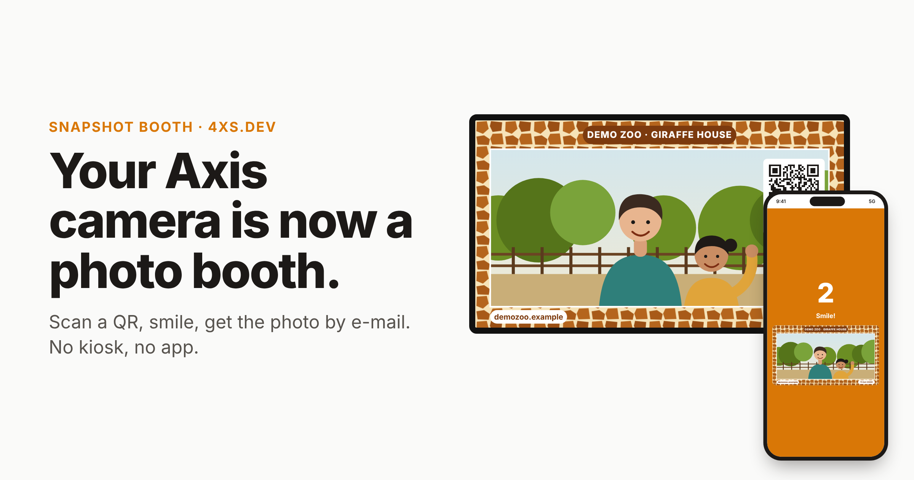

# Snapshot Booth for Axis

**Scan. Smile. Check your inbox.** Snapshot Booth turns an AXIS camera into a QR photo booth. Visitors scan a printed QR code, type their e-mail and pick a background. The camera counts down on their phone, on an optional preview screen and with its front status LED, then e-mails them a photo (up to 4K) with your CamOverlay frame on it.

No app, no kiosk PC, no port forwarding.

- **Website:** https://booth.4xs.dev · **Admin:** https://booth.4xs.dev/admin
- **Visitor flow with mockups:** [docs/index.html](docs/index.html) (GitHub Pages)

## Download

Get the latest build from [Releases](../../releases/latest):

| File | Camera | Install as |
|---|---|---|
| `Snapshot_Booth_<version>_aarch64.eap` | ARTPEC-8, ARTPEC-9, CV25 | Signed ACAP — camera → Apps → Add app |
| `Snapshot_Booth_<version>_armv7hf.eap` | ARTPEC-7 | Signed ACAP — camera → Apps → Add app |
| `snapshot_booth_box_<version>.zip` | ARTPEC-6, ARTPEC-7, ARTPEC-8, ARTPEC-9, CV25 | CamScripter package — CamScripter → Install package |

Not sure which chip? It is in the camera's *System → About*.

## Requirements

- ACAP: AXIS OS 12.10 or newer. CamScripter package: any camera running CamScripter (30-day trial at [camstreamer.com](https://www.camstreamer.com)).
- Photo resolution set on the camera: up to 4K on ARTPEC-8, ARTPEC-9 and CV25, up to 1440p on ARTPEC-6 and ARTPEC-7.
- Bench-tested on AXIS Q1656 (ARTPEC-8) and AXIS M1075 (CV25).
- Outbound HTTPS from the camera to `booth.4xs.dev`.
- CamOverlay for the frame / backgrounds (services at the booth's photo resolution, set under Camera access → Image).
- A camera user with **Operator** rights for the app.

## Setup

1. Sign in at [booth.4xs.dev/admin](https://booth.4xs.dev/admin) with your e-mail → **Add a camera** → you get a one-time PIN.
2. Install the `.eap` (or the CamScripter `.zip`) on the camera.
3. Open the app's settings page → **Activation** → enter the PIN. The camera shows up in the admin as online.
4. On the settings page: camera user, booth name, texts, logo, backgrounds (CamOverlay at the photo resolution), photo delivery, QR boxes.
5. Download the QR from the admin (pick the camera under **Cameras**) and print it. Optional: open `http://<camera>/local/snapshot_booth/screen.cgi` on a TV or tablet on the camera's network as a preview screen.
6. **Take test photo** on the settings page checks the LED and capture without sending anything.

## Pricing

The first camera on your account is free, with no time limit. Each further camera is €5 per month, paid on [Ko-fi](https://ko-fi.com/pavelk) (card or PayPal). No per-photo fees.

## Privacy

Visitors give explicit consent. Photos and e-mail addresses are deleted automatically after 3 days by default (configurable per camera), and every e-mail contains a link to delete the photo immediately.

---

© 2026 Pavel Kotyza <kotyza@gmail.com> · [4xs.dev](https://4xs.dev) · MIT licence (see `LICENSE`).
AXIS is a trademark of Axis AB. Snapshot Booth is an independent product, not affiliated with or endorsed by Axis.
