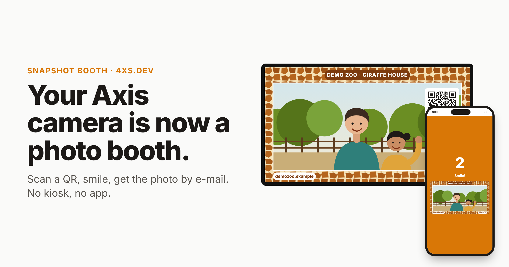

# Snapshot Booth for Axis

**Scan. Smile. Check your inbox.** Snapshot Booth turns an AXIS camera into a QR photo booth. Visitors scan a printed QR code, type their e-mail and pick a background. The camera counts down on their phone, on an optional preview screen and with its front status LED, then e-mails them a 1920×1080 photo with your CamOverlay frame on it.

No app, no kiosk PC, no port forwarding.

- **Website:** https://booth.4xs.dev · **Admin:** https://booth.4xs.dev/admin
- **Visitor flow with mockups:** [docs/index.html](docs/index.html) (GitHub Pages)

## Download

Get the latest build from [Releases](../../releases/latest):

| File | Install as |
|---|---|
| `Snapshot_Booth_<version>_aarch64.eap` | ACAP — camera → Apps → Add app (allow unsigned apps) |
| `snapshot_booth_camscripter_<version>.zip` | CamScripter package — CamScripter → Install package |

## Requirements

- AXIS OS 12 (11.x should work), aarch64 camera: ARTPEC-8, ARTPEC-9, CV25. Bench-tested on AXIS Q1656.
- Outbound HTTPS from the camera to `booth.4xs.dev`.
- CamOverlay for the frame / backgrounds (1920×1080 services).
- A camera user with **Operator** rights for the app.

## Setup

1. Install the `.eap` (or the CamScripter `.zip`) on the camera.
2. Open the app's settings page → **Register this camera** with your e-mail → click the confirmation link. It signs you in to the admin, where all cameras registered with that e-mail are listed.
3. Enter the camera user and password → **Save**. Status shows "Connected to booth server".
4. Design the frame in CamOverlay at 1920×1080. In the admin, name your backgrounds and pick the overlays for each.
5. Print the QR from the admin. Optional: open `http://<camera>/local/snapshot_booth/screen.cgi` on a TV or tablet on the camera's network as a preview screen.
6. **Take test photo** on the settings page checks the LED and capture without sending anything.

## Pricing

USD 5 per camera per month after a 7-day trial on your account. Pay with PayPal or Ko-fi in the admin.

## Privacy

Visitors give explicit consent. Photos and e-mail addresses are deleted automatically after 3 days by default (configurable per camera), and every e-mail contains a link to delete the photo immediately.

---

© 2026 Pavel Kotyza <kotyza@gmail.com> · [4xs.dev](https://4xs.dev) · MIT licence (see `LICENSE`).
AXIS is a trademark of Axis AB. Snapshot Booth is an independent product, not affiliated with or endorsed by Axis.
